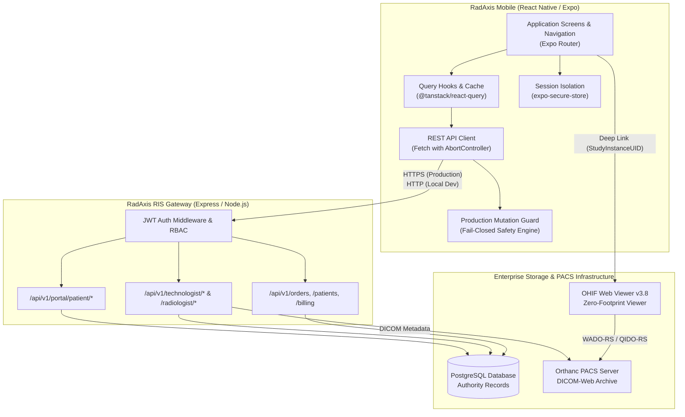
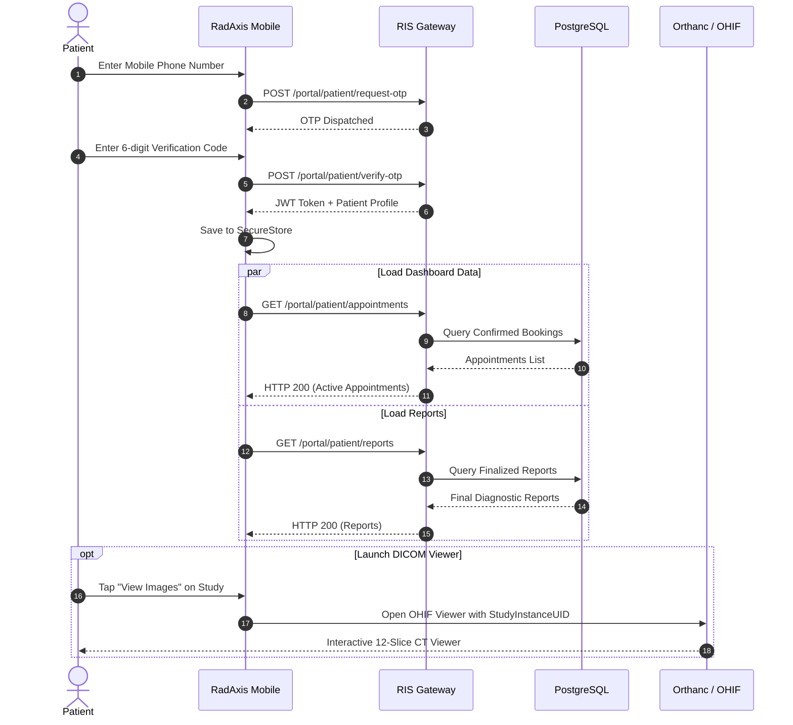
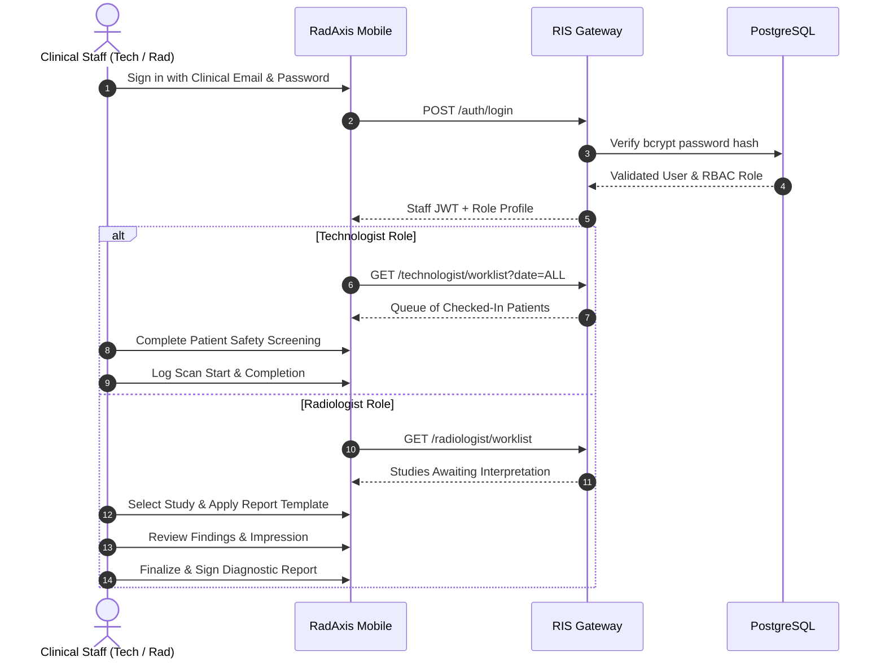

# RadAxis Mobile

> A mobile companion to the existing RadAxis Radiology Information System, extending patient services, clinical workflows, imaging management, and hospital operations beyond the desktop.

---

## 1. Introduction

**RadAxis Mobile** is a specialized cross-platform mobile application engineered with React Native and Expo. Designed as a direct extension to the web-based RadAxis Radiology Information System (RIS), it provides dedicated mobile experiences tailored to two primary stakeholder groups:
1. **Patients**: Self-service appointment scheduling, preparation instructions, digital diagnostic reports, and direct DICOM image viewing.
2. **Clinical Staff**: Mobile worklist tracking, patient intake verification, examination status oversight, reporting triage, critical alert notifications, and equipment operational readiness.

The mobile application acts as a secure client, consuming unified RESTful APIs exposed by the centralized RadAxis RIS backend gateway.

---

## 2. Project Objectives

- **Operational Mobility**: Enable radiology technicians, attending radiologists, and clinic receptionists to interact with real-time departmental queues and study statuses from mobile devices.
- **Patient Engagement**: Empower patients to track their imaging journey from order requisition and self-service booking to report delivery without requiring in-person desk queues.
- **DICOM Viewer Integration**: Stream multi-frame diagnostic DICOM studies on mobile devices via embedded OHIF Viewer v3.8 sessions powered by Orthanc PACS.
- **Clinical Data Integrity & Safety**: Enforce strict fail-closed production mutation safeguards to protect authoritative electronic health records while supporting rich local staging demonstrations.

---

## 3. Key Features

### Patient Portal
- **Secure Phone Verification**: Mobile authentication via one-time SMS verification code (OTP).
- **Appointment Self-Service**: Real-time examination catalog exploration (CT, MRI, X-Ray, Ultrasound) and available slot booking.
- **Preparation Guidance**: Modality-specific examination preparation checklists (e.g., fasting hours, contrast screening questions).
- **Diagnostic Reports & Imaging**: Instant access to signed diagnostic reports and integrated DICOM web viewing for finalized studies.

### Clinical Staff Modules
- **Role-Based Home Consoles**: Dynamic dashboards customized for Administrators, Radiologists, Receptionists, and Technologists.
- **Master Patient Index (MPI)**: Rapid directory search by Patient Name, Medical Record Number (MRN), or phone number with full jacket history.
- **Technologist Worklist**: Queue management for scheduled examinations, patient safety screening checklists, scan acquisition logging, and image quality checks.
- **Radiologist Workspace**: Modality reporting queues, structured diagnostic templates (CT, MRI, Chest Radiograph), study claiming, and report draft review.
- **Reception & Queue Management**: Daily patient check-in, real-time waiting room queue tracking, and token assignment.
- **Critical Findings & Alerts**: STAT triage queue for urgent radiologist findings with structured verbal read-back acknowledgment workflows.
- **Hospital Inventory & Equipment**: Real-time scanner operational status (CT, MRI, X-Ray) and medical supply stock levels with low-stock alerts.

---

## 4. Technology Stack

| Layer | Technology | Description |
| :--- | :--- | :--- |
| **Framework** | [React Native](https://reactnative.dev/) `0.88.1` / [Expo SDK](https://expo.dev/) `58` | Cross-platform native mobile application engine |
| **Language** | [TypeScript](https://www.typescriptlang.org/) `~6.0.3` | Type-safe application development across all modules |
| **Routing** | [Expo Router](https://docs.expo.dev/router/introduction/) `~58.0.32` | File-system based typed navigation and deep linking |
| **State & Cache** | [@tanstack/react-query](https://tanstack.com/query/latest) `^5.108` | Asynchronous server state caching, background polling, and cache invalidation |
| **Security Storage** | [expo-secure-store](https://docs.expo.dev/versions/latest/sdk/securestore/) | Hardware-backed Keychain / Keystore session token isolation |
| **Form Management** | [react-hook-form](https://react-hook-form.com/) + [Zod](https://zod.dev/) | Validated form handling and structured schema validation |
| **UI Components** | React Native StyleSheet + Custom Design System | High-contrast clinical UI tokens, responsive flexbox layout, and dark/light adaptive styling |
| **Build Pipeline** | [Expo Application Services (EAS)](https://expo.dev/eas) | Cloud-managed standalone Android APK and AAB compilation |

---

## 5. System Architecture



---

## 6. Mobile and Existing RIS Backend Integration

RadAxis Mobile connects directly to the existing RadAxis RIS server over HTTPS. Communication adheres strictly to RESTful JSON standards:

- **Authentication**: JWT tokens issued via `POST /api/v1/auth/login` (clinical staff) and `POST /api/v1/portal/patient/verify-otp` (patients).
- **Session Isolation**: Staff tokens are keyed to `radaxis_auth_token`, while patient portal sessions use `radaxis_patient_auth_token`. Separate route groups (`app/(app)/*` vs `app/(patient)/*`) prevent privilege escalation.
- **Timeout Management**: Network requests utilize native `AbortController` with a configurable 15-second timeout window.
- **Production Guard Policy**: To prevent accidental data corruption or unverified writes during demonstration usage, a client-side mutation engine enforces read-only safety when connected to the live production host (`meril-ris.mangesh.my.id`). Non-persisted operations truthfully report *"Preview only — no changes saved."*

---

## 7. Patient Workflow



---

## 8. Clinical Staff Workflow



---

## 9. Project Structure

```text
mobile/
├── app/                          # Expo Router application screens & navigation
│   ├── (app)/                    # Clinical staff navigation group
│   │   ├── (tabs)/               # Staff bottom navigation tabs (Home, Worklist, Alerts)
│   │   ├── billing.tsx           # Hospital billing invoices & receipt detail
│   │   ├── equipment.tsx         # Operational scanner assets & maintenance
│   │   ├── inventory.tsx         # Hospital inventory items & stock levels
│   │   ├── patients.tsx          # Master Patient Index & Patient Jacket
│   │   ├── radiologist.tsx       # Radiologist diagnostic reporting workspace
│   │   ├── reception.tsx         # Patient check-in & waiting queue
│   │   └── study/                # Diagnostic examination detail & DICOM launcher
│   ├── (auth)/                   # Authentication flows (Staff login & Patient OTP)
│   ├── (patient)/                # Patient portal navigation group
│   │   ├── (tabs)/               # Patient bottom tabs (Home, Book, Reports, Profile)
│   │   └── prep/                 # Examination preparation instructions
│   └── _layout.tsx               # Root application entry layout & provider wrapper
├── assets/                       # Branding logos, splash icons, and vector symbols
├── src/                          # Reusable core library
│   ├── auth/                     # Token storage & authentication context providers
│   ├── components/               # Specialized UI widgets (cards, headers, badges, pills)
│   ├── constants/                # Runtime configuration, endpoints & safety rules
│   ├── hooks/                    # React Query integration hooks by clinical module
│   ├── services/                 # REST API client services (portal, clinical, billing)
│   ├── theme/                    # Color palettes, typography scales & layout constants
│   ├── types/                    # Shared TypeScript interfaces & clinical domain models
│   └── utils/                    # Data formatters, age calculators & string utilities
├── __tests__/                    # Automated unit, security isolation & safety test suites
├── app.config.js                 # Dynamic Expo configuration & Android manifest modifications
├── app.json                      # Static application manifest & EAS project binding
├── eas.json                      # EAS Build profiles (preview, staging, production)
├── package.json                  # Dependencies, metadata & project scripts
└── tsconfig.json                 # TypeScript compiler configuration
```

---

## 10. Local Development Setup

### Prerequisites
- [Node.js](https://nodejs.org/) v20.x or higher
- [npm](https://www.npmjs.com/) v10.x or higher
- Android Studio / Android SDK (for physical device debugging or local emulator)
- [Expo Go](https://expo.dev/go) app (optional for local testing) or EAS CLI

### Installation
Clone the repository and install dependencies:

```bash
git clone https://github.com/mangesh-lomte/radaxis-mobile.git
cd radaxis-mobile
npm install
```

---

## 11. Environment Configuration

The application requires environment variables to locate the backend REST API gateway.

Copy the template configuration:

```bash
cp .env.example .env
```

Configure variables in `.env`:

```ini
# Base URL of the RadAxis RIS REST API Gateway
EXPO_PUBLIC_API_BASE_URL=https://meril-ris.mangesh.my.id/api/v1

# Target Environment: 'production' | 'staging'
EXPO_PUBLIC_APP_ENV=production

# Developer Preview Mode (must remain false for standard operation)
EXPO_PUBLIC_DEV_PREVIEW_MODE=false
```

### Environment Isolation Policy
- **Production (`EXPO_PUBLIC_APP_ENV=production`)**: Strict HTTPS enforced. Local cleartext HTTP traffic is disabled. Client-side mutation guards prevent modification of live database records.
- **Staging / Development (`EXPO_PUBLIC_APP_ENV=staging`)**: Cleartext HTTP traffic is permitted over local network interfaces (`android:usesCleartextTraffic=true`) to enable testing against local staging servers.

---

## 12. Running the Application

Start the local Metro development server:

```bash
npm start
```

Target-specific launch shortcuts:

```bash
# Launch on connected Android device / emulator
npm run android

# Launch in web preview
npm run web
```

---

## 13. Testing

RadAxis Mobile includes automated test suites covering unit formatting, security isolation, and runtime mutation safety:

```bash
# Run core test suites
npm test

# Run TypeScript static type checking
npm run typecheck
```

### Test Coverage Highlights
- **Demographics Verification (`demographics.test.ts`)**: Confirms date parsing, age calculations, and gender abbreviation formatting across patient cohorts.
- **Runtime Safety (`runtimeSafety.test.ts`)**: Validates that production host requests strictly block unpersisted mutations.
- **Security Isolation (`securityIsolation.test.ts`)**: Ensures separate SecureStore key partitions for patient and clinical staff JWT tokens.

---

## 14. Build Configuration

Standalone Android binaries are built via Expo Application Services (EAS):

```bash
# Build standalone Android APK for production preview
npx eas-cli build --platform android --profile preview

# Build standalone Android APK for local staging testing
npx eas-cli build --platform android --profile preview-staging
```

### Profiles Overview (`eas.json`)
- **`preview`**: Standalone APK targeting production HTTPS gateway (`com.radaxis.mobile`).
- **`preview-staging`**: Standalone APK targeting local staging gateway (`com.radaxis.mobile.staging`).
- **`production`**: Production release APK/AAB bundle with production signing keystore.

---

## 15. Current Limitations

- **SMS Delivery Gateway**: Public patient self-registration and dynamic OTP delivery currently rely on clinic demonstration mode or local evaluation numbers until a commercial SMS provider (e.g., Twilio or AWS SNS) is provisioned on the backend gateway.
- **Offline DICOM Caching**: Large multi-frame CT and MRI DICOM studies require an active network connection to stream from the Orthanc PACS server; local offline DICOM caching is not currently supported.
- **Production Write Restrictions**: Under production preview configurations, write operations on financial transactions and finalized reports are blocked client-side to prevent tampering with live clinical data.
- **Platform Scope**: The current release focuses on Android tablet and phone form factors; iOS builds require provisioning certificates under an active Apple Developer Program account.

---

## License

This project is proprietary software developed for the RadAxis Radiology Information System. All rights reserved.
